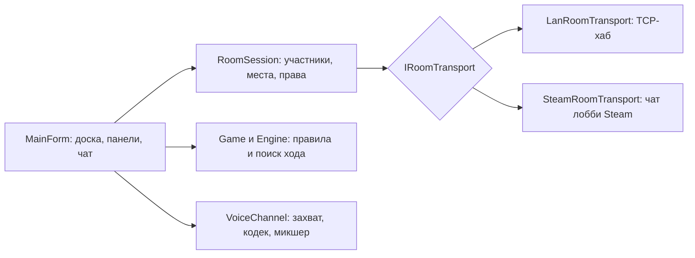

# ♟️ Chess WinForms

> Шахматы для Windows: игра с компьютером, вдвоём за одним ПК и по сети (локальная сеть или Steam) — с комнатами, зрителями, текстовым и голосовым чатом.

🌐 **Язык / Language:** [Русский](README.md) · [English](README_EN.md)


## 📌 Обзор

Окно с доской, игрой против встроенного движка, режимом «вдвоём» и сетевыми комнатами. Один человек создаёт комнату, за столом садятся двое, остальные (до 10 человек в комнате) наблюдают, пишут в чат и говорят в микрофон. Хост решает, кого пускать и кому что разрешено.

Ничего устанавливать не нужно: достаточно Windows 10/11, а собирается проект компилятором `csc.exe`, который уже есть в системе (Visual Studio и .NET SDK не нужны).

> [!NOTE]
> Режим Steam использует общий тестовый AppID Spacewar (480): на время игры в вашем профиле виден статус «Играет в Spacewar». Библиотека `steam_api64.dll` принадлежит Valve и в репозиторий не входит — игра сама находит её в установленных играх Steam.

## 📸 Скриншоты

| Хост и входящие запросы | Вкладка «Люди» |
| --- | --- |
|  |  |

| Зритель в чате | Свободное место за столом (светлая тема) |
| --- | --- |
|  |  |

## ✨ Возможности

- Три режима: против компьютера (5 уровней от «Новичка» до «Мастера»), вдвоём за одним компьютером, по сети.
- Полные правила: рокировка, взятие на проходе, превращение пешки, мат, пат, недостаточный материал, правило 50 ходов, троекратное повторение, сдача и ничья по соглашению.
- Сетевая комната до 10 человек: двое играют, остальные смотрят; можно встать из-за стола в зрители и сесть обратно.
- Хост подтверждает вход каждого участника и ведёт партию: ходы, сдача, ничья и реванш проходят через него и проверяются.
- Права зрителей: чат и голос можно отключить всем зрителям сразу или одному человеку; любой может заглушить кого-то только у себя.
- Передача роли хоста другому участнику (в Steam мгновенно, в локальной сети — с переездом комнаты и проверкой доступности).
- Если игрок вышел, партия приостанавливается; её продолжит тот, кто сядет на свободное место.
- Текстовый и голосовой чат: 16 кГц, IMA ADPCM, детектор речи, автоматическая громкость, смешивание нескольких говорящих, индикаторы говорящих.
- Ход в ожидании (premove), подсказка, просмотр прошлых позиций, анимация хода, звуки.
- Тёмная и светлая темы, 4 стиля доски, масштабирование под DPI.
- Нет зависимостей: только .NET Framework 4.8, который есть в Windows 10/11.

## 🏗️ Как это работает



Хост — единственный, кто пишет состояние комнаты и партии. Игроки отправляют ему запросы, он проверяет их и рассылает результат, поэтому все копии игры видят события в одном порядке и подделать ход чужой копией нельзя.

| Строка | Направление | Назначение |
| --- | --- | --- |
| `MOVE <ply> <uci>`, `RESIGN`, `DRAW*`, `NEW*` | игрок → хост | запросы игроков (принимаются только от тех, кто сидит за столом) |
| `PLAYED`, `RESULT`, `OFFER`, `NEWGAME`, `SYNC` | хост → все | подтверждённые события партии, полное состояние для вошедших позже |
| `ROOM <rev> <host> <flags> <members>` | хост → все | участники, места, права; применяется только по возрастанию версии |
| `CHAT`, `VOICE` | любой → все | проверяются по правам комнаты у отправителя и у каждого получателя |

## 🚀 Быстрый старт

### Готовая сборка

1. Откройте раздел [Releases](https://github.com/soroka01/Chess-WinForms/releases) и скачайте архив последней версии.
2. Распакуйте в любую папку (не запускайте из архива) и откройте `Chess.exe`.
3. Если Windows пишет «Windows защитила ваш компьютер» — нажмите «Подробнее» → «Выполнить в любом случае» (программа не подписана).

### Сборка из исходников

```bat
git clone https://github.com/soroka01/Chess-WinForms.git
cd Chess-WinForms
build.bat
```

`build.bat` собирает `Chess.exe` компилятором `csc.exe` из .NET Framework 4.x (есть в Windows). Код написан на C# 5.

### Игра по сети

Все участники запускают одну и ту же версию игры и выбирают режим «По сети».

**Локальная сеть (Wi-Fi или кабель)**

1. Хост выбирает своё место за столом (белые, чёрные или зритель), соединение «Локальная сеть» и нажимает «Создать игру». Внизу появится его IP-адрес.
2. Остальные нажимают «Подключиться…», выбирают игру в списке (она находится автоматически) или вводят IP вручную, выбирают «Играть» или «Смотреть».
3. Если Windows спросит про брандмауэр — «Разрешить доступ».

**Steam**

1. Все запускают Steam и входят в аккаунт; в поле «Соединение» выбирают «Steam».
2. Хост нажимает «Создать игру», остальные — «Подключиться…» и находят комнату в списке (друзья отмечены ★, у каждой комнаты видно, сколько человек играет и смотрит).
3. Если `steam_api64.dll` не найдена автоматически, положите её рядом с `Chess.exe` (она есть в папке любой игры Steam).

## 🕹️ Управление

| Клавиши | Действие |
| --- | --- |
| Мышь | перетаскивание или два клика; пока ходит соперник, можно выбрать ход в ожидании |
| `Ctrl+N` / `Ctrl+Z` | новая партия / отменить ход (не в сетевой игре) |
| `F` | повернуть доску |
| `H` | подсказка (не в сетевой игре) |
| `← →`, `Home`, `End` | просмотр прошлых позиций; `End` или `Esc` — вернуться к игре |
| `Esc` / правая кнопка | отмена хода в ожидании |
| `T` / `M` | тёмная/светлая тема / звук |
| `V` | микрофон вкл/выкл (в сетевой игре) |

## 🧪 Тесты

Тесты — консольные программы, собираемые из тех же исходников (папка `tests/`).

| Скрипт | Что проверяет |
| --- | --- |
| `tests\run-tests.bat` | движок: перфт-проверка генератора ходов, партии движка с движком |
| `tests\run-room-tests.bat` | комната (`RoomSession`) на in-memory-транспорте: вход, места, права, передача хоста |
| `tests\run-lan-room-tests.bat` | TCP-транспорт LAN: хаб, переподключения, лимиты, передача хаба |
| `tests\run-voice-tests.bat` | кодек, детектор речи, джиттер-буфер, микшер |
| `tests\run-net-tests.bat [группа]` | целые окна игры: партии, зрители, права, передача хоста, чат и голос (LAN и имитация Steam) |

Тестовые окна открываются за пределами экрана; зависший тест сам останавливается и печатает, где застрял.

## 🗂️ Структура проекта

```text
Chess-WinForms/
├── src/
│   ├── Position.cs, Game.cs, Engine.cs   # правила, партия, поиск хода
│   ├── RoomSession.cs                    # комната: участники, места, права, хост
│   ├── RoomTransport.cs                  # интерфейсы транспортов
│   ├── LanRoomTransport.cs               # TCP-хаб, обнаружение, переезд хаба
│   ├── SteamRoomTransport.cs             # комната поверх лобби Steam
│   ├── SteamLobbyService.cs, SteamLink.cs # Steam API без SDK: загрузка DLL и лобби
│   ├── Voice.cs                          # микрофон, кодек, микшер, динамик
│   ├── MainForm*.cs                      # окно, сетевая игра, чат, вкладка «Люди»
│   ├── BoardControl.cs, PlayerBar.cs, ChatControl.cs, PeopleList.cs, ...
│   └── Theme.cs, Themed*.cs              # собственная отрисовка и темы
├── tests/                                # тесты и заглушки (лобби, аудио, транспорт)
├── docs/screenshots/                     # картинки для README
├── build.bat                             # сборка Chess.exe
├── chess.ico
└── LICENSE
```

## 🔒 Безопасность и приватность

- Хост решает, кто играет, пишет и говорит, но общение комнаты не секретно. Пока человек ждёт решения хоста, его копия игры уже получает общие сообщения комнаты (ходы, чат, голос).
- В режиме Steam всё идёт через общий чат лобби: любой, кто в него вошёл, получает те же сообщения, пока его копия игры не вышла; исключение из комнаты выполняет сама программа участника.
- При передаче хоста в локальной сети новый хост получает служебные ключи участников (по ним комната узнаёт вернувшихся). Передавайте роль тем, кому доверяете.
- Микрофон слышат все в комнате. Зовите тех, кому доверяете.
- Для режима Steam игра загружает только `steam_api64.dll` с подписью Valve и проверяет, что в ней есть нужные функции.

## ⚠️ Ограничения

- Только Windows (WinForms, winmm); код на C# 5 и .NET Framework 4.8.
- Нет шахматных часов и экспорта партии (PGN).
- Подсказка и отмена хода в сетевой игре отключены.
- Если хост закрыл игру или потерял связь, комната закрывается без выбора нового хоста — передайте роль заранее.
- Голос по Steam идёт через чат лобби; если говорят сразу несколько человек, звук может прерываться (в локальной сети такого нет).
- Передача хоста по локальной сети через два разных компьютера с брандмауэром и комната из нескольких настоящих аккаунтов Steam проверены только в автотестах на loopback и имитации лобби.
- Качество голоса умеренное: кодек IMA ADPCM; для остального лучше наушники.

## 📄 Лицензия

[MIT](LICENSE).

## 💬 Поддержка

Можно [форкнуть репозиторий](https://github.com/soroka01/Chess-WinForms/fork) и доработать под себя. Если проект пригодился, поставьте [Star](https://github.com/soroka01/Chess-WinForms) — так я увижу, что он был кому-то полезен.

---

with love ❤️
