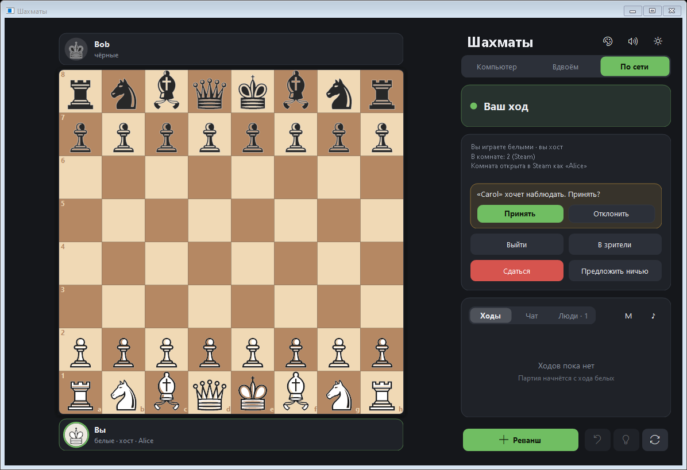
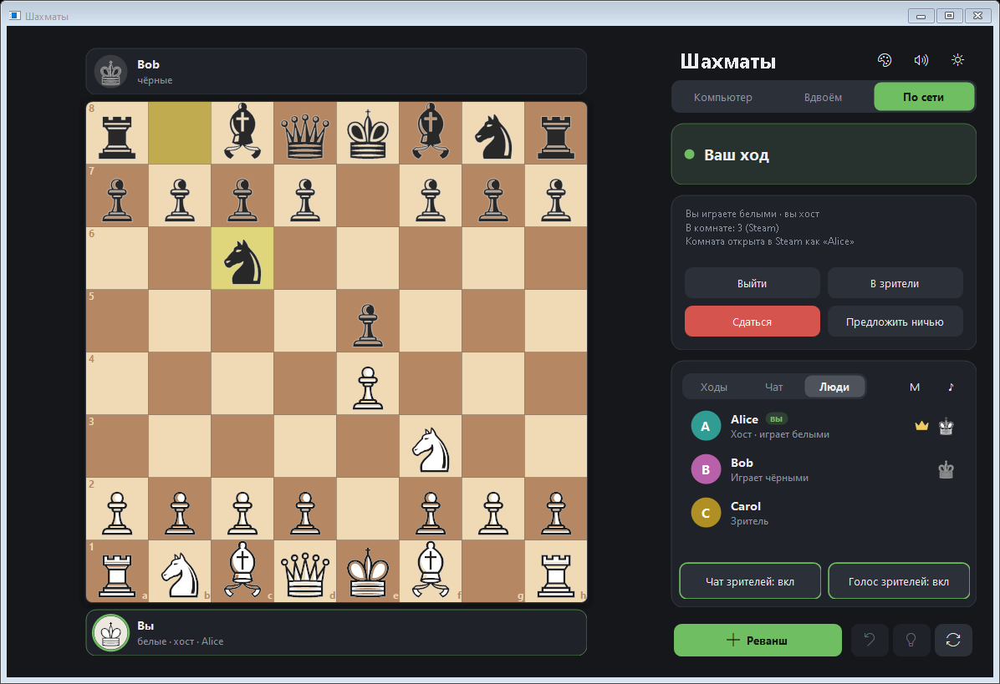
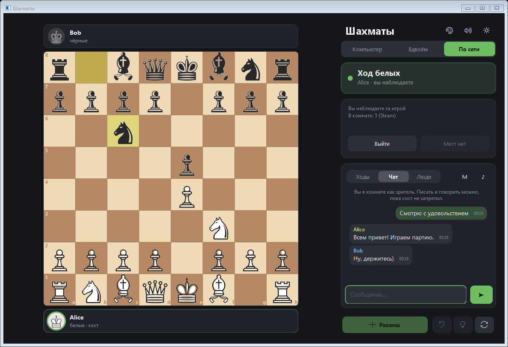
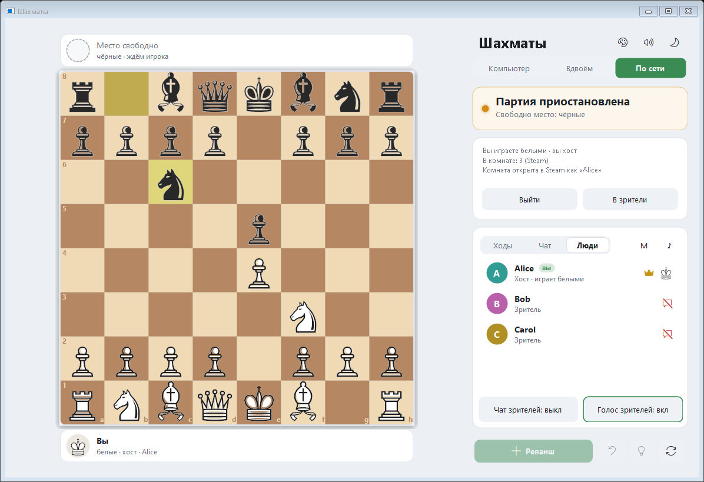
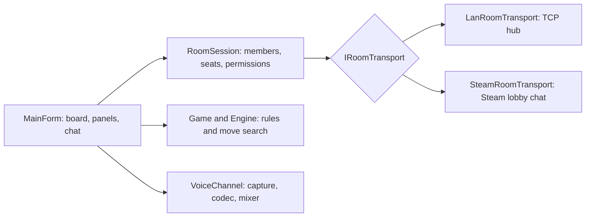

# ♟️ Chess WinForms

> Windows chess: play the computer, a friend on the same PC, or over the network (LAN or Steam) — with rooms, spectators, text and voice chat.

🌐 **Язык / Language:** [Русский](README.md) · [English](README_EN.md)


## 📌 Overview

A board window with a built-in engine, a hot-seat mode and network rooms. One person opens a room, two sit at the board, everybody else (up to 10 people in a room) watches, types in the chat and talks on the microphone. The host decides who may join and who may do what.

Nothing has to be installed: Windows 10/11 is enough, and the project is built with the `csc.exe` compiler that ships with the system (no Visual Studio or .NET SDK needed).

> [!NOTE]
> The Steam mode uses the shared test AppID Spacewar (480): while a room is open your Steam profile shows "Playing Spacewar". `steam_api64.dll` belongs to Valve and is not part of this repository — the game finds it in your installed Steam games on its own.

## 📸 Screenshots

| Host and incoming requests | "People" tab |
| --- | --- |
|  |  |

| Spectator in the chat | A free seat at the table (light theme) |
| --- | --- |
|  |  |

## ✨ Features

- Three modes: against the computer (5 levels from "Beginner" to "Master"), two players on one PC, and network.
- Full rules: castling, en passant, promotion, checkmate, stalemate, insufficient material, the fifty-move rule, threefold repetition, resignation and agreed draws.
- Network rooms of up to 10 people: two play, the others watch; anybody can stand up to become a spectator and sit down again.
- The host approves every newcomer and runs the game: moves, resignation, draws and rematches go through it and are validated.
- Spectator permissions: chat and voice can be switched off for all spectators or for one person; anybody can silence someone just for themselves.
- Hand-over of the host role to another member (instant on Steam; on a LAN the room moves to the new host's PC after a reachability check).
- If a player leaves, the game pauses; whoever sits at the free seat continues it.
- Text and voice chat: 16 kHz IMA ADPCM, voice activity detection, automatic gain, mixing of several speakers, speaking indicators.
- Queued move (premove), hint, review of earlier positions, move animation, sounds.
- Dark and light themes, 4 board styles, DPI scaling.
- The game version is shown in the window title and under the buttons; when a newer version is released on GitHub, a "… available — update" line appears there (click it and the game offers to open the download page; it never downloads anything itself).
- No dependencies: only .NET Framework 4.8, which Windows 10/11 already has.

## 🏗️ How it works



The host is the only writer of the room and of the game. Players send it requests, it validates them and announces the result, so every copy of the game sees the events in the same order and a moved piece cannot be forged from another copy.

| Line | Direction | Purpose |
| --- | --- | --- |
| `MOVE <ply> <uci>`, `RESIGN`, `DRAW*`, `NEW*` | player → host | player requests (accepted only from those sitting at the table) |
| `PLAYED`, `RESULT`, `OFFER`, `NEWGAME`, `SYNC` | host → everyone | confirmed game events, the whole game for late joiners |
| `ROOM <rev> <host> <flags> <members>` | host → everyone | members, seats, permissions; applied only with a growing revision |
| `CHAT`, `VOICE` | anyone → everyone | checked against the room's permissions by the sender and by every receiver |

## 🚀 Quick start

### Ready-made build

1. Open [Releases](https://github.com/soroka01/Chess-WinForms/releases) and download the archive of the latest version.
2. Unpack it to any folder (do not run it from inside the archive) and open `Chess.exe`.
3. If Windows says "Windows protected your PC", click "More info" → "Run anyway" (the program is not signed).

### Building from source

```bat
git clone https://github.com/soroka01/Chess-WinForms.git
cd Chess-WinForms
build.bat
```

`build.bat` builds `Chess.exe` with `csc.exe` from .NET Framework 4.x (part of Windows). The code is C# 5.

### Network play

Everybody runs the same version of the game and picks the "Network" mode.

**Local network (Wi-Fi or cable)**

1. The host picks a seat (white, black or spectator), the "Local network" connection and presses "Create game". Their IP address appears at the bottom.
2. The others press "Connect…", pick the game from the list (it is discovered automatically) or type the IP, and choose to play or to watch.
3. If Windows asks about the firewall, choose "Allow access".

**Steam**

1. Everybody starts Steam and signs in; the "Connection" field is set to "Steam".
2. The host presses "Create game", the others press "Connect…" and find the room in the list (friends are marked ★, each room shows how many people play and watch).
3. If `steam_api64.dll` is not found automatically, put it next to `Chess.exe` (it is in the folder of any Steam game).

## 🕹️ Controls

| Keys | Action |
| --- | --- |
| Mouse | drag or click twice; while the opponent thinks you can queue a move |
| `Ctrl+N` / `Ctrl+Z` | new game / take a move back (not in network games) |
| `F` | flip the board |
| `H` | hint (not in network games) |
| `← →`, `Home`, `End` | review earlier positions; `End` or `Esc` returns to the game |
| `Esc` / right click | cancel a queued move |
| `T` / `M` | dark/light theme / sound |
| `V` | microphone on/off (network games) |

## 🧪 Tests

The tests are console programs built from the same sources (the `tests/` folder).

| Script | What it checks |
| --- | --- |
| `tests\run-tests.bat` | the engine: perft check of the move generator, engine-versus-engine games |
| `tests\run-room-tests.bat` | the room (`RoomSession`) on an in-memory transport: joining, seats, permissions, host hand-over |
| `tests\run-lan-room-tests.bat` | the LAN TCP transport: hub, reconnects, limits, hub hand-over |
| `tests\run-voice-tests.bat` | codec, voice detection, jitter buffer, mixer |
| `tests\run-net-tests.bat [group]` | whole game windows: games, spectators, permissions, host hand-over, chat and voice (LAN and a fake Steam) |

Test windows open off-screen; a test that hangs stops by itself and prints where it is stuck.

## 🗂️ Project structure

```text
Chess-WinForms/
├── src/
│   ├── Position.cs, Game.cs, Engine.cs   # rules, game, move search
│   ├── RoomSession.cs                    # the room: members, seats, permissions, host
│   ├── RoomTransport.cs                  # transport interfaces
│   ├── LanRoomTransport.cs               # TCP hub, discovery, hub relocation
│   ├── SteamRoomTransport.cs             # a room on top of a Steam lobby
│   ├── SteamLobbyService.cs, SteamLink.cs # Steam API without the SDK: DLL loading and lobbies
│   ├── SteamDllStamp.cs                  # fingerprint of the Steam DLL: notice that Steam changed it
│   ├── AppInfo.cs, UpdateChecker.cs      # the game version and the check for a newer one on GitHub
│   ├── Voice.cs                          # microphone, codec, mixer, speaker
│   ├── MainForm*.cs                      # window, network game, chat, "People" tab
│   ├── BoardControl.cs, PlayerBar.cs, ChatControl.cs, PeopleList.cs, ...
│   └── Theme.cs, Themed*.cs              # custom drawing and themes
├── tests/                                # tests and stand-ins (lobby, audio, transport)
├── docs/screenshots/                     # README images
├── build.bat                             # builds Chess.exe
├── chess.ico
└── LICENSE
```

## 🔒 Security & privacy

- The host decides who plays, writes and speaks, but room traffic is not secret. While a person waits for the host's decision, their copy of the game already receives the room's shared messages (moves, chat, voice).
- In the Steam mode everything travels through the shared lobby chat: anybody who has entered it receives the same messages until their copy of the game leaves; removing someone from the room is carried out by that member's own program.
- When the host role is handed over on a LAN, the new host receives the members' service keys (the room recognises returning people by them). Hand the role over to people you trust.
- Everybody in the room hears the microphone. Invite people you trust.
- For the Steam mode the game loads only a `steam_api64.dll` signed by Valve and checks that it exports the functions it needs.
- The game remembers which `steam_api64.dll` it used (path, size, version, hash). If Steam updated or removed that file, it is checked again like any other; a file that loaded but did not work is skipped until Steam replaces it with a different build.
- Every few hours the game makes one request to `api.github.com` (the latest release) to learn about a new version. To switch it off, put `updates=0` into `%APPDATA%\ChessGame\settings.ini`.

## ⚠️ Limitations

- Windows only (WinForms, winmm); the code is C# 5 on .NET Framework 4.8.
- No chess clocks and no game export (PGN).
- Hint and take-back are disabled in network games.
- If the host closes the game or loses the connection, the room closes without choosing a new host — hand the role over beforehand.
- Voice on Steam goes through lobby chat; with several people talking at once the sound may break up (not on a LAN).
- A LAN hand-over between two different computers behind a firewall and a room of several real Steam accounts have only been tested with automated tests on loopback and on a fake lobby.
- Voice quality is moderate: the IMA ADPCM codec; headphones are better, otherwise the microphone picks up the speakers.

## 📄 License

[MIT](LICENSE).

## 💬 Support

You can [fork the repository](https://github.com/soroka01/Chess-WinForms/fork) and adapt it to your needs. If the project was useful, please give it a [Star](https://github.com/soroka01/Chess-WinForms) — it shows me that someone found it useful.

---

with love ❤️
